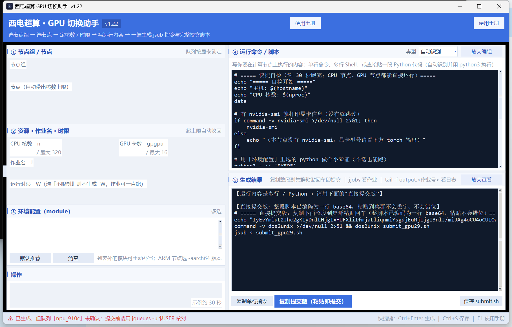

<div align="center">


# 西电超算 · GPU 切换助手

**图形化 JSUB 作业提交助手 —— 选节点、写代码，一键生成「粘贴即提交」的集群脚本**

免安装 · 单文件 exe · 队列按显卡自动锁定 · 实测跑通

[](#-版本历史)
[](https://www.python.org/)
[](https://github.com/sakurajh/gpu-switch-helper/releases)
[](LICENSE)
[](https://github.com/sakurajh/gpu-switch-helper/actions/workflows/build.yml)

[功能特性](#-功能特性) · [快速开始](#-快速开始) · [使用指南](#-使用指南) · [项目结构](#-项目结构) · [版本历史](#-版本历史)



</div>

---

## ✨ 功能特性

- 📦 **双击即用**：单文件 exe（约 8.7 MB），无需安装 Python，直接发给别人也能用
- 🖥️ **双栏现代界面**：左侧选 **节点组 / 节点 / 核数 / 时限 / 环境 module**，右侧写运行内容 + 实时看生成结果
- 🔒 **队列按显卡自动锁定**：选了节点就自动带上正确的队列名，杜绝 `Queue <xxx> is not found`
- 📋 **三种提交产物一键生成**：
  | 产物 | 用途 |
  |---|---|
  | 单行 `jsub` 指令 | 快速提交简单命令 |
  | `#JSUB` 完整脚本 | 常规提交（`jsub < submit.sh`） |
  | **base64 直接提交版** | 整段脚本编码为一行，**粘贴到集群不会乱码、不会错位**，中文注释/输出都安全 |
- 🐍 **Python 代码自动识别**：在界面里直接写 Python，自动用 heredoc 打包并调用集群 Python 环境执行
- 🧰 **内置平台实测 module 清单**：CUDA 11.8~13.2、PyTorch 2.5.1、MPI、GROMACS / LAMMPS / NAMD / VASP / WRF 等二十余个，点选即用
- 🛡️ **输入防呆**：核数超上限自动收回（手滑输入 `8bc` 会保留已打对的 `8`）、作业名与时限校验、未确认队列黄条提醒
- 💾 **记住上次填写**：内容自动保存在用户目录，下次打开还在；「重置」一键清空
- ⌨️ **快捷键**：`Ctrl+Enter` 生成 · `Ctrl+S` 保存脚本 · `F1` 使用手册
- 🧪 **内置自测与冒烟**：`--selftest` 逻辑自测（含队列名核对）、`--guismoke` 完整构建界面自动验证
- 📖 **内置使用手册**：`F1` 随时打开，含 CPU/GPU 队列对照表与提交示例

## 🚀 快速开始

### 方式一：直接用打包好的 exe（推荐）

> 仓库内自带最新版 [`GPU切换助手.exe`](../../releases)，双击即可运行，无需安装任何依赖。

也可以自己构建：安装 Python 3.8+ 后双击 **`build.bat`**，自动完成「自测 → 打包 → 复制成品」。

### 方式二：源码运行

```bash
python gpu_switch_app.py            # 打开图形界面
python gpu_switch_app.py --selftest # 逻辑自测（含队列名核对），结果写 gpu_switch_selftest.txt
python gpu_switch_app.py --guismoke # 完整构建界面，2.2 秒后自动关闭
python gpu_switch_app.py --smoke    # 基础 GUI 冒烟
```

### 三步提交作业

```text
① 左栏：选节点组 → 选节点 → 核数 / 时限 / 环境 module
② 右栏：写运行内容（命令 / Shell / Python 均可）
③ 点「复制提交版（粘贴即提交）」→ 粘贴到集群登录节点回车，作业就交上去了
```

查看作业与结果：

```bash
jjobs                     # 看作业状态
tail -f output.<作业号>    # 看输出
jctrl kill <作业号>        # 取消作业
```

## 📖 使用指南

更完整的说明（含 **CPU/GPU 队列对照表**、module 推荐与提交示例）见：

- [使用手册.html](使用手册.html) —— 软件内按 `F1` 打开的同一份手册
- [西电超算_GPU切换手册.md](西电超算_GPU切换手册.md) —— 集群使用速查

**实测记录（v1.22，test44 账号）**

| 验证项 | 结果 |
|---|---|
| GPU 队列提交（gpu15 / gpu_6000ada） | ✅ 作业 Successfully completed，`NVIDIA RTX 6000 Ada` |
| base64 直接提交版 md5 比对 | ✅ 集群解码后与本地文件**完全一致** |
| 界面写 Python → 一键生成 → 提交 | ✅ torch 2.5.1 / CUDA 可用，中文输出正常 |
| CPU fat/thin 队列（cpu_x86fat / cpu_x86thin） | ✅ 接受提交 |
| 故意写错代码的反向验证 | ✅ error.<作业号> 有完整 traceback，不静默失败 |

## 📁 项目结构

```text
GPU切换助手/
├── gpu_switch_app.py        # 软件源码（改完双击 build.bat 即可重新打包）
├── GPU切换助手.spec          # PyInstaller 打包配置（相对路径，换机器也能打包）
├── build.bat                # 一键：自测 → 打包 → 复制成品
├── version_copy.py          # 打包收尾脚本（被 build.bat 调用）
├── icon_gen.py              # 图标生成脚本（重新生成 icon.png / icon.ico）
├── icon.ico / icon.png      # 程序图标
├── gpu_switch.sh            # 登录集群后用的交互式切换脚本（Linux）
├── 使用手册.html             # 内置使用手册（F1 打开的同一份）
├── 西电超算_GPU切换手册.md    # 集群使用速查手册
├── GPU切换助手.exe           # 成品（单文件，可直接发给别人）
└── .github/workflows/       # GitHub Actions 自动打包 Windows exe
```

## 🔄 版本历史

<details open>
<summary><b>v1.22</b>（2026-09-28，当前版本）</summary>

- 修掉两个会导致提交失败的队列名错误：`fat01-06` 的 `cpu_x86_fat` → `cpu_x86fat`；`cu06-13` 的 `cpu_x86` → `cpu_x86thin`
- ARM 三组与 cu01-05 队列经实测确认，不再显示「队列未确认」黄条
- 手册补 CPU 队列对照表；示例 module 改为平台真实存在的 `cuda/12.6.3`、`python/pytorch-2.5.1`
- 自测新增「队列名核对」项，防止改回错误队列名

</details>

<details>
<summary><b>v1.21</b></summary>

- 界面改为左右双栏，按钮就近放置，新增底部状态栏
- 字号按高分屏 150% 缩放调校，窗口自适应；图标改为运行时相对路径查找
- 记住上次填写内容；新增 `Ctrl+Enter` / `Ctrl+S` / `F1` 快捷键
- 修复核数框输入非数字卡死、无控制台模式下异常被静默吞掉等问题

</details>

## ⚠️ 注意事项

- `H200` / `PRO6000` 队列平台存在，但**可能没对你的账号开通**；NPU 组（gpu29）目前无对应队列。提交前用 `jqueues -u $USER` 核对，软件会黄条提醒
- 手动上传脚本时先 `dos2unix` 再提交（「复制提交版」已自动处理）
- 界面回调出错会弹窗并写入 `切换助手_错误.log`，方便排查

## 📄 License

本项目基于 [MIT License](LICENSE) 开源。
